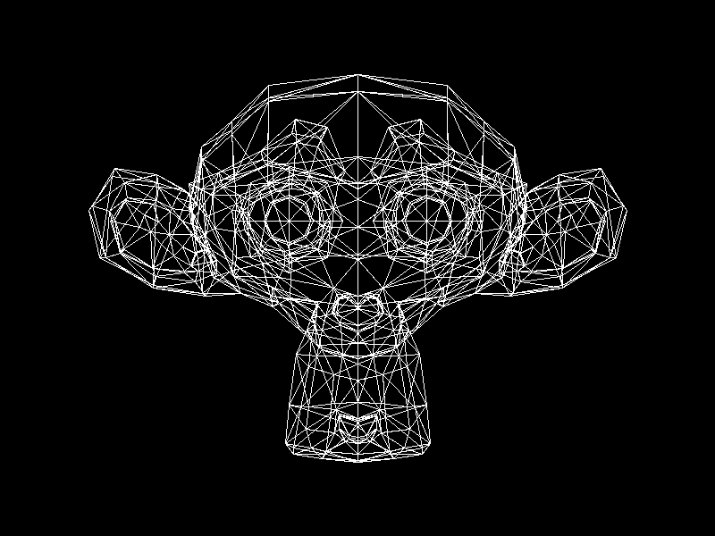

# Lab 4: Carga de modelos (Wireframe)

Carga y renderizado en modo Wireframe del modelo Suzanne.obj osea el monito del blender pero triangulado, ademas reutilizando el Framebuffer y algoritmo de líneas del Lab 1.

## Como funciona

- Se lee el archivo Suzanne.obj línea por línea en src/obj.zig.
- Luego se obtienen los puntos 3D que empiezan con v  osea sus coordenadas x, y, z y los triángulos que empiezan con f  osea tambien tomando el primer num antes de cada / y restandole 1 para que empiece desde 0.
- Despues en src/main.zig se pasan los puntos de cada triángulo a coordenadas 2D usando -v.y  para que el monito salga recto y se dibujan sus 3 aristas en blanco.
- Finalmente se guarda automáticamente el resultado en out.bmp y out.png.

## Resultado



## Build

```bash
zig build run
```
